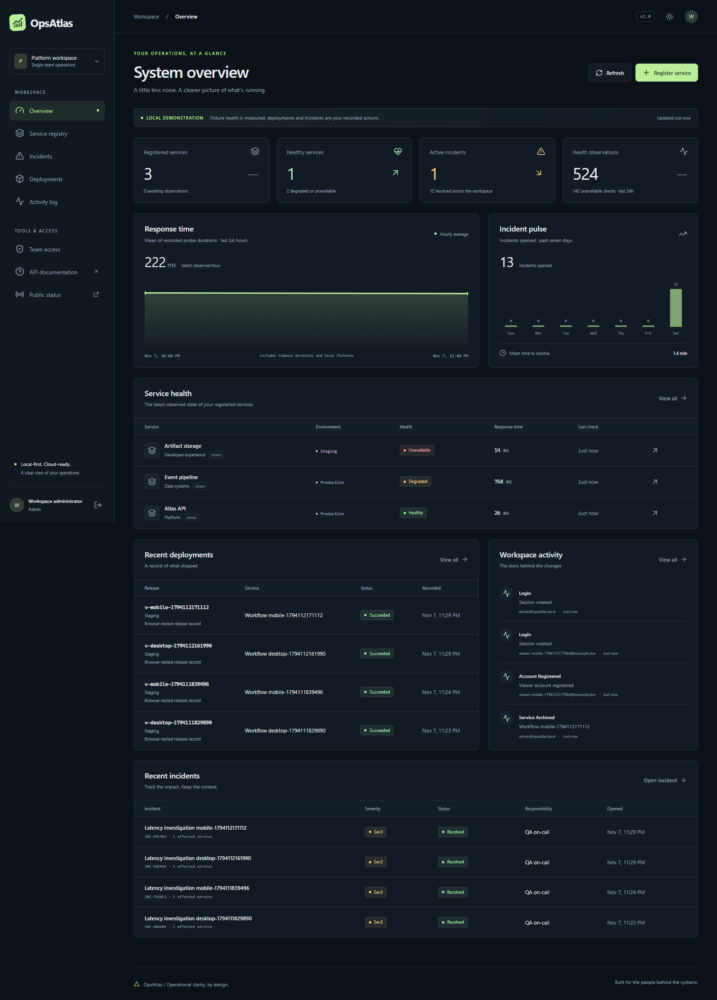
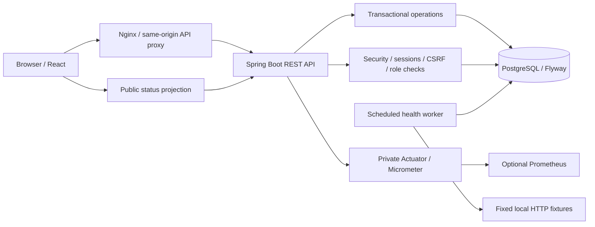
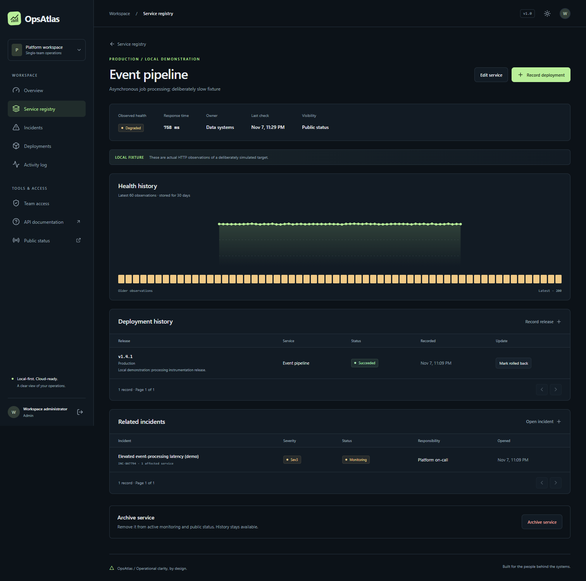
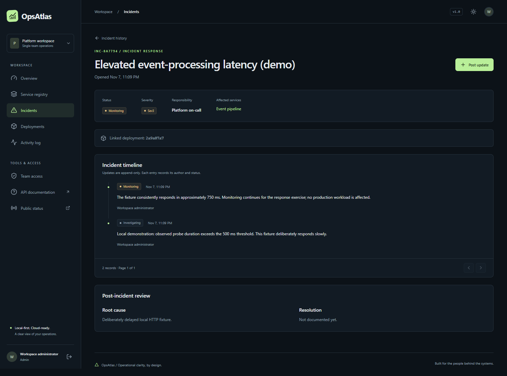
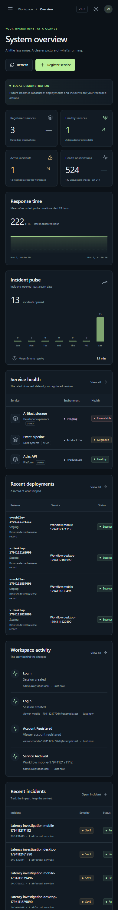
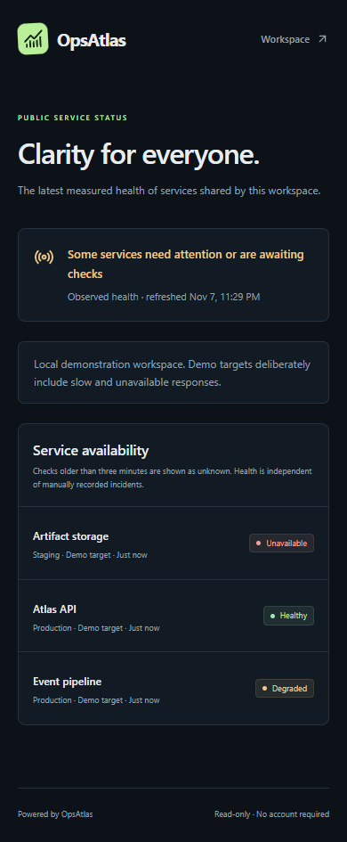

# OpsAtlas

[](https://github.com/elilovescoding/opsatlas/actions/workflows/ci.yml)

A working, single-team service operations platform for registering applications,
observing health, recording releases, and coordinating incident response. Built
with Java 21, Spring Boot, React, TypeScript, and PostgreSQL, with Docker local
development and an AWS deployment design in Terraform.

OpsAtlas connects engineering decisions to operational context: which service is
affected, what shipped, who is responding, what happened, and how it was resolved.
It records releases; it does **not** execute software deployments from the UI.

> Local portfolio project. Fixture health comes from real HTTP checks against
> intentionally healthy, slow, and unavailable demonstration targets. No external
> production systems are monitored. Cloud resources have not been provisioned.



## What you can do

- Register and sign in with BCrypt-hashed passwords and database-backed sessions.
  New members are viewers; administrators grant operator access.
- Create, search, filter, edit, and archive services across development, staging,
  and production. Archived records retain their incident and release history.
- Select fixed local monitoring targets and review measured status, response time,
  timestamps, and recent health history. A scheduler stores actual observations.
- Record releases and transition pending deployments to succeeded/failed, then
  mark succeeded releases rolled back. Link an incident to an affected release.
- Open multi-service incidents, set severity and responsibility, append timeline
  updates, and resolve with a mandatory root cause and resolution.
- Review transactional audit events, seven-day incident counts, health sample
  totals, hourly probe latency, and mean time to resolve.
- Publish selected services on a minimal, read-only public status page.
- Use a responsive dashboard with dark and light themes, keyboard-accessible
  dialogs, useful empty/error states, and server-enforced permissions.

## Stack

| Area | Technology |
| --- | --- |
| API | Java 21, Spring Boot 4.1.2, Spring MVC, Bean Validation |
| Security | Spring Security, BCrypt cost 12, Spring Session JDBC, CSRF |
| Persistence | PostgreSQL 17, Spring Data JPA, Flyway |
| Web | React 19.3.1, TypeScript 5.9, Vite 8, responsive CSS |
| Operations | Actuator, Micrometer, Prometheus exposition, ECS JSON logs |
| Tests | JUnit, MockMvc, PostgreSQL/Testcontainers, Vitest, Testing Library, Playwright |
| Delivery | Multi-stage Dockerfiles, Docker Compose, GitHub Actions |
| Cloud design | Terraform, EC2, encrypted EBS, SSM, CloudWatch, private S3 |

Dependencies were checked against official compatibility documentation and package
registries. Frontend dependency versions are locked in `package-lock.json`; the
AWS provider is locked in `.terraform.lock.hcl`. See [dependency decisions](docs/DEPENDENCIES.md).

## Verification status

| Area | Evidence | Status |
| --- | --- | --- |
| Application | Native PostgreSQL, API, and React workflows | Verified locally |
| Automated tests | Backend, frontend, and desktop/mobile browser journeys | See [release report](docs/RELEASE_READINESS.md) |
| Security | Source scans, npm audit, Maven OSV lookup, and container image review | [Results and remaining findings](docs/RELEASE_READINESS.md) |
| Docker Compose | Image builds, container health, workflows, Prometheus and persistence across recreation | Verified locally on November 9, 2026 |
| GitHub Actions | Backend, frontend, infrastructure and browser jobs | [Hosted CI runs](https://github.com/elilovescoding/opsatlas/actions/workflows/ci.yml) |
| Terraform | Formatting and provider-schema validation | Validated; not applied |
| AWS deployment | Inert workflow template, no active AWS workflow | Not deployed |

Operations and audit records commit together. Each authenticated request
checks its session role against PostgreSQL. Fixed-address monitoring keeps
probe URLs outside user control, while incident timelines preserve the sequence
of status changes and their authors.

## Architecture



This is a deliberately understandable modular monolith. The browser and API share
one origin; no bearer tokens are stored in browser storage. PostgreSQL stores both
domain data and expiring sessions. Mutations and their audit events commit in one
transaction. [Architecture and schema](docs/ARCHITECTURE.md) explain the boundaries,
constraints, locking, pagination, and tradeoffs.

## Run with Docker

Requirements: Git, Docker Engine/Desktop with Compose **2.24.6+**, at least 4 GiB
available memory for builds, and an unused local TCP port 8088. The local Compose
stack, including optional Prometheus, passed verification on Docker Desktop's
Linux engine. See [verification](docs/VERIFICATION.md).

```sh
git clone https://github.com/elilovescoding/opsatlas.git
cd opsatlas
cp config/environment.example .env
# Edit .env privately: set POSTGRES_PASSWORD, BOOTSTRAP_EMAIL, BOOTSTRAP_PASSWORD.
# Choose unique random values; bootstrap password must be 16–72 UTF-8 bytes.
docker compose config --quiet
docker compose up --build --wait --wait-timeout 180
```

On PowerShell, use `Copy-Item config/environment.example .env` instead of `cp` if preferred.
Open [http://localhost:8088](http://localhost:8088), then sign in with your configured
bootstrap account. The first health check runs about one minute after startup.

```sh
docker compose ps
docker compose logs -f backend
docker compose --profile observability up -d
# Optional Prometheus: http://localhost:9091
docker compose down
```

`down` preserves PostgreSQL data. **`down -v` destroys local database volumes.**
Changing `POSTGRES_PASSWORD` after initialization does not rotate the database
role password; follow the [runbook](docs/RUNBOOK.md). Bootstrap only creates an
absent administrator; changing its environment password does not reset it.

## Run natively on Windows

Requires PowerShell 7, Node 24 (or 22.12+), Java 21, and Python 3.12+ for the optional
portable PostgreSQL extraction. No administrator access or system PATH changes.

```powershell
Set-Location path/to/opsatlas
# Portable Maven/PostgreSQL download if they are not already installed locally:
./scripts/setup-tools.ps1
# Set JAVA_HOME to your installed Java 21 JDK, or add its bin directory to PATH.
./scripts/dev.ps1
```

Open [http://127.0.0.1:5173](http://127.0.0.1:5173). The native script generates
random local credentials in ignored `.env` if absent; open it privately to retrieve
the bootstrap email/password. It creates PostgreSQL databases `opsatlas` and
`opsatlas_test` on loopback port 55432. The API listens on loopback ports 8080/8081;
the fixtures use 9090. Logs/PIDs/data stay in ignored `.runtime/`.

```powershell
./scripts/stop.ps1 # Stops this project's processes and preserves all local data.
```

Stop and start after backend code changes. The launcher copies the runnable JAR
into `.runtime/` so builds can replace `backend/target` safely on Windows.

For Linux native development, start PostgreSQL 17, create a database, export
`DATABASE_URL`, `DATABASE_USER`, `DATABASE_PASSWORD`, `BOOTSTRAP_EMAIL`, and
`BOOTSTRAP_PASSWORD`; run `mvn -f backend/pom.xml spring-boot:run`. In separate
terminals run `node scripts/demo-targets.mjs` and `cd frontend && npm ci && npm run dev`.
Set `DEMO_ENABLED=true` to initialize the three fixture services.

## First walkthrough

1. Sign in as the bootstrap administrator. The demo registry contains Atlas API
   (healthy), Event pipeline (slow/degraded), and Artifact storage (503/unavailable).
2. Register a service, choose an environment/owner, and select a fixed demo target.
   Select `None` for a registry-only entry; it remains `Unknown`.
3. Open its detail page and record a release. Mark a pending release succeeded or
   failed. This operation writes a record and an audit event.
4. Open an incident for that service, optionally link the release, and add a
   timeline update. Resolve it after entering a root cause and resolution.
5. Reload the page to verify persistence. Review the release, timeline, dashboard,
   and activity history. Archive the service after its incidents are resolved.
6. Create a separate viewer account; use **Team access** as the administrator to
   grant/revoke operator permissions. Role changes revoke the member's sessions.
7. Open [the public status page](http://localhost:8088/status) without signing in.
   Only services explicitly marked public appear.

## API documentation

After signing in, open `/api/docs` for Swagger UI or `/v3/api-docs` for the OpenAPI
document. REST endpoints live under `/api`; JSON uses enum values such as
`PRODUCTION`, `SEV2`, `INVESTIGATING`, and `SUCCEEDED`.

Mutations require the session cookie **and** `X-CSRF-TOKEN` from `/api/auth/csrf`.
Public routes are CSRF bootstrap, registration/login, and `/api/public/status`.
Logout is `POST /api/auth/logout`. See [API contracts and examples](docs/API.md).

## Tests and checks

```sh
# With Java 21 + Maven + a running Docker Engine (Testcontainers starts PostgreSQL):
mvn -B -ntp -f backend/pom.xml spotless:check verify
cd frontend
npm ci
npm run lint
npm run format:check
npm test
npm run build
npm audit --audit-level=moderate
npx playwright install chromium
# Export BOOTSTRAP_EMAIL/PASSWORD for the running local demo first.
npm run test:e2e
```

For Windows native development, `./scripts/test-backend.ps1` uses the dedicated
native `opsatlas_test` database. Tests never fall back to H2 and never silently
skip database verification. Browser tests create real, clearly named exercise
records and retain their history. [Verification evidence](docs/VERIFICATION.md)
records the native and Compose runs separately from hosted CI and AWS.

## Screenshots

These images were captured from the running local application with measured
fixture health and explicitly labeled demonstration release/incident records.
They are not generated mockups. Fresh databases contain services only; releases
and incidents remain empty until recorded.




| Mobile overview | Public status |
| --- | --- |
|  |  |

## AWS and Terraform

The cost-conscious design uses one `t3.small` Linux EC2 instance in a public subnet,
TLS through Caddy, a private container network, and a separately encrypted EBS data
volume. Administration uses SSM; no SSH, PostgreSQL, API, or Actuator ingress is
opened. Docker logs go to CloudWatch. A private, expiring S3 prefix holds approved
release bundles. No NAT gateway, load balancer, RDS instance, or Kubernetes cluster.

**Planning estimate: roughly $22–28/month** in US East for continuous, light demo
use, before tax/domain registration/large egress or backups. This is an estimate,
not an AWS quote or spending cap. [Cloud architecture and costs](docs/AWS.md)
include source prices, exact resources, provisioning, DNS/TLS, backups, teardown,
and the single-host availability tradeoff.

```sh
terraform -chdir=infrastructure/terraform fmt -check -recursive
terraform -chdir=infrastructure/terraform init -backend=false
terraform -chdir=infrastructure/terraform validate
# An AWS-authenticated plan requires separate review. Do not apply without approval.
```

AWS delivery is an **inert template outside `.github/workflows`**. GitHub cannot
register or dispatch it unless the owner explicitly moves it into that directory.
The template additionally requires a typed confirmation, an enable variable,
main branch, an approved environment, and OIDC configuration. It never runs
Terraform. See [delivery safeguards](docs/DELIVERY.md).

## Security and deliberate limitations

- Parameterized queries/JPA, database constraints, validated DTOs, safe problem
  responses, transactional writes, server authorization, CSRF, session fixation
  protection, HTTP-only cookies, and sensitive-route rate limiting.
- Monitoring accepts named fixture keys, not URLs. Fixed literal IPs, no DNS,
  no redirects, timeouts, and discarded bodies keep SSRF surface narrow.
- Native HTTP is loopback-only. Cloud cookies require HTTPS; the Caddy overlay
  sets secure cookies and HSTS. Management metrics stay on a separate private port.
- One shared team, no tenant isolation. The application does not implement email
  verification, password recovery, MFA, alert delivery, or cloud inventory APIs.
- Dashboard metrics describe this application and observed probes. They are not
  host CPU/RAM/cloud cost telemetry. Prometheus exposes JVM/process metrics;
  the AWS design adds EC2 CPU/status alarms.
- This is not an HA system or an independent external uptime monitor. A host loss
  takes the application, database, and monitor offline together. Backups need
  off-host storage and restore practice before important use.

See [security assumptions](docs/SECURITY.md) and [interview tradeoffs](docs/INTERVIEW.md).

## Repository guide

```text
backend/                 Spring Boot API, migrations, tests
frontend/                React application, component and browser tests
infrastructure/terraform/ AWS infrastructure; local validation only
infrastructure/          Prometheus and Caddy configuration
scripts/                 Native development, demo targets, backup, manual deploy
docs/                    Architecture, contracts, runbooks, verification, screenshots
.github/workflows/       CI and optional dependency security scan only
config/                  Blank environment configuration template
infrastructure/workflow-templates/  Inert AWS delivery template
```

Future improvements are multi-team isolation, verified email/password recovery,
external monitoring agents, alert integrations, restore automation, remote
Terraform state, independent availability monitoring, and an HA deployment when
budget and requirements justify it. These are future work, not advertised features.

## Ownership and license

Portfolio project by **elilovescoding**, developed with assistant collaboration.
The [interview guide](docs/INTERVIEW.md) explains implementation decisions and
contains four evidence-based resume bullets.

Licensed under [MIT](LICENSE).
