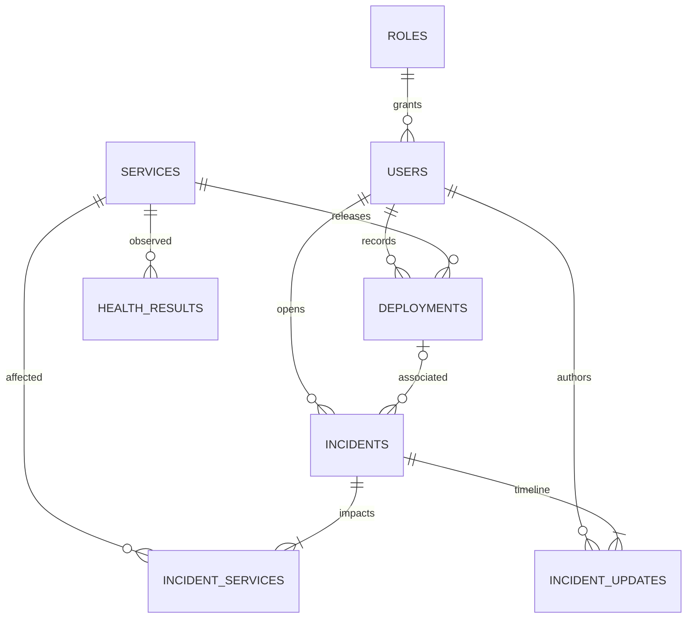

# Architecture and data model

## Application boundaries

The application serves one trusted team. Everyone authenticated can read workspace
operational data; operators/admins can mutate it. Public users see only a separate,
minimal projection of services explicitly shared by an operator. This is not a
multi-tenant authorization model.

Controllers validate JSON DTOs and identify the caller. `Operations` owns business
transactions; repositories own persistence. Entities are package-private and never
serialized directly. Explicit record projections prevent accidental hash/session
exposure. `HealthMonitor` performs bounded HTTP I/O outside database transactions;
`HealthRecorder` briefly locks/rechecks configuration before saving observations.

## Tables and constraints

| Table | Purpose and integrity |
| --- | --- |
| `roles` | Three allowed role names, referenced by users |
| `users` | UUID, normalized unique email, display name, BCrypt hash, one role |
| `services` | Unique name/environment, owner, description, archive/public/demo flags, target, latest health, version |
| `deployments` | Service/user FKs, release identifier, environment, status, notes, creation time |
| `incidents` | Severity/status, responsibility, optional deployment FK, root cause/resolution, open/resolved timestamps, version |
| `incident_services` | Unique incident/service pair, real FKs in both directions |
| `incident_updates` | Append-only application timeline entries with author/status/time |
| `health_results` | Service FK, observed state/duration/HTTP code/time |
| `audit_events` | Actor, action, resource ID, bounded detail, UTC creation time |
| `spring_session*` | Expiring, persisted HTTP sessions managed by Spring Session JDBC |

Flyway `V1__schema.sql` creates all tables, constraints, indexes, and the role lookup.
`V2__session_principal_length.sql` widens the session principal index to match the
254-character account email limit.
Hibernate validates rather than mutates the schema. UUIDs avoid reliance on sequence
allocation across API requests; they are identifiers, not authorization secrets.
Timestamps are PostgreSQL `timestamptz` and Java `Instant`. Native PostgreSQL may
have a local server timezone; trend days follow its database session day. The
Docker database uses UTC. UI timestamps display in the viewer's timezone.

Indexes support service/environment discovery, incident status/time, service
deployment history, incident joins, health history/retention, audit chronology,
and session expiration/principal lookup. FKs use restrictive deletion; the UI
archives services instead of deleting operational history.

## Transactional invariants

- An operational mutation and its audit event commit together.
- Deployment environment must equal the service's current environment at creation.
  Older deployment environments remain historical if a service later changes.
- A linked deployment must belong to an affected incident service.
- Service locks serialize archive/change/create operations. Multi-service incident
  creation acquires service locks in UUID order to reduce deadlock risk.
- Incident/deployment updates lock their rows. Incident states can stay the same
  for a timeline note or advance; they cannot move backwards. Resolved incidents
  are immutable. A follow-up incident is a new record.
- Resolution requires nonblank root cause and resolution, with a database check
  tying status to `resolved_at`. PostgreSQL backs application constraints.
- Archiving requires no open incidents. An existence query checks the complete
  incident set, independent of list pagination.
- Health I/O does not hold a database lock. Persistence rechecks the target and
  archive flag, discarding stale work if configuration changed during the probe.

## Reads, pagination, and retention

Collections accept zero-based `page` and bounded `size` (1–100; page 0–10000).
Stable time/UUID sorting avoids nondeterministic ties. Services accept name and
environment filters, deployments a service filter, incidents service/status filters.
The incident collection is fetched inside a read transaction without a collection
fetch join, so database pagination remains effective.

The dashboard performs SQL aggregates and bounded recent-list requests. Missing
latency/MTTR is displayed as missing, never filled with fictional values. Incident
days include real zero counts. Health observations expire after 30 days through an
hourly task. Sessions expire after 30 idle minutes. Deployment, incident and audit
history have no automatic deletion in this portfolio scope.

The UI's searchable service picker shows up to 100 matching services and preserves
selected IDs; narrow the search for larger registries. Related deployment choices
show the latest 100 matching release records. Complete histories remain paginated
through the REST API.

## Health semantics

`UNKNOWN` means disabled, never checked, or stale on the public page. `HEALTHY`
means a 2xx response in at most 500 ms; `DEGRADED` is a slower 2xx; `UNAVAILABLE`
means non-2xx, timeout, or transport failure. Redirects are failures. Durations
include failed/timeout observations; the dashboard does not call them request
throughput or production latency. Incident status is manually managed and does
not overwrite measured health.

The default schedule is one pass every 60 seconds after completion. Three fixture
targets use port 9090 and fixed paths. Native development uses 127.0.0.1; Docker
uses static 172.30.0.10. Each request has 2 s connection and 4 s total timeout,
redirects disabled, bodies discarded, and no user-controlled URL/host/path/header.
Probes are sequential; this is suitable for a small team, not thousands of targets.

## Tradeoffs

A monolith and JDBC sessions minimize moving parts and make transactions easy to
explain. A separate read model, queue, Redis, Kubernetes, and microservices would
add cost without solving current requirements. Future scale would require bounded
probe concurrency, distributed scheduling/locks, metric rollups, audit retention,
database capacity planning, and tenant-aware authorization.
