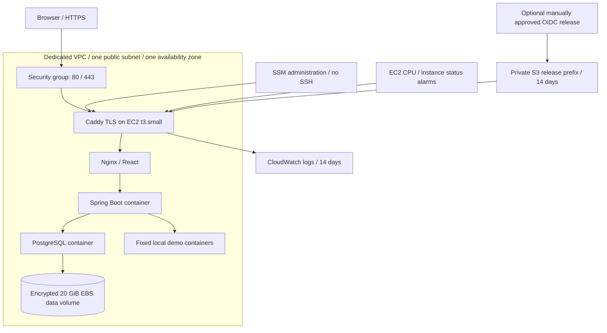

# AWS deployment design, costs, and approval boundaries

**No AWS resources have been created. Terraform has only been validated locally.**
An authenticated plan, resource provisioning, DNS/TLS, IAM behavior, host bootstrap,
and deployment all require a later, explicitly approved AWS exercise.



## Exactly what Terraform describes

- VPC 10.42.0.0/16, one /24 subnet, Internet gateway, route table/association.
- Security group allowing HTTP/HTTPS from configurable IPv4 CIDRs. Outbound TCP
  80/443 for packages, TLS, AWS APIs. No SSH, database, API, or management ingress.
- One x86 Amazon Linux 2023 EC2 `t3.small` (2 vCPU / 2 GiB), 12 GiB encrypted gp3
  root volume, on-demand public IPv4, no key pair, no NAT/load balancer/RDS.
- A separate encrypted 20 GiB gp3 volume and attachment for PostgreSQL data.
  `prevent_destroy` deliberately blocks accidental data-volume deletion.
- EC2 IAM role/profile: narrowly scoped SSM channel APIs, log stream writes, and
  GetObject on only this project's release prefix. Wildcard resource permissions
  appear only for SSM APIs that do not support resource scoping.
- One CloudWatch log group with 14-day retention and CPU/instance-status alarms.
  Alarms have no notification action unless an existing SNS ARN is configured.
- One encrypted, public-access-blocked S3 bucket, TLS-only bucket policy, 14-day
  artifact expiration, no force-destroy. It contains release bundles, not secrets.
- Optional OIDC deployment role only when an existing GitHub OIDC provider ARN
  is deliberately supplied. Trust is restricted to `elilovescoding/opsatlas` and
  the `aws-production` environment. No OIDC provider/account connection is created.

User data installs Docker/Compose, waits for the attached volume, formats **only
an unformatted device**, mounts by UUID, and installs a container metadata guard.
Docker requires the storage unit before booting on subsequent restarts. The
application is not installed or started by Terraform. Credentials never go into
Terraform variables, state, outputs, or user data.

## Planning cost estimate

Estimate checked November 7, 2026, USD, roughly 730 hours/month in US East, light
demo traffic, excluding tax, domain, large transfers, and off-host backup storage.
Recheck the calculator in your account before approval. Prices are not a cap.

| Item | Assumption | Approximate monthly cost |
| --- | --- | ---: |
| t3.small Linux | ~$0.0209/hour × 730 | $15.26 |
| gp3 | 32 GiB combined root/data × ~$0.08 | $2.56 |
| Public IPv4 | $0.005/hour × 730 | $3.65 |
| Logs, two alarms, small S3 releases | Low volume, short retention | ~$1–6 |
| **Planning range** | Continuous demo use | **~$22–28** |

Sources: [AWS T3 pricing](https://aws.amazon.com/ec2/instance-types/t3/),
[EBS pricing](https://aws.amazon.com/ebs/pricing/),
[VPC IPv4 pricing](https://aws.amazon.com/vpc/pricing/),
[CloudWatch pricing](https://aws.amazon.com/cloudwatch/pricing/), and
[S3 pricing](https://aws.amazon.com/s3/pricing/). No free-tier credit is assumed.

CPU credits use **standard** mode to avoid unlimited-mode surplus charges; sustained
CPU can be throttled. Images are built in CI, not on the small host. Memory limits
leave little room for extra tools; the optional Prometheus profile adds pressure.
The root disk stores image layers, so prune unused images carefully and monitor
space. Repeated large release bundles or logs increase costs. Configure an AWS
Budget manually before provisioning; a budget alert does not stop charges.

## Before provisioning

1. Finish the Docker release gate locally/on an approved CI run.
2. Review the entire Terraform diff and estimate. Select a region and a DNS name
   you control; domain registration is separate and is not performed here.
3. Use official AWS CLI SSO/secure login. Run `aws sts get-caller-identity` privately
   and verify the intended account. Never paste access keys into chat.
4. Copy `terraform.tfvars.example` to ignored `terraform.tfvars`; set nonsecret
   configuration. Leave `github_oidc_provider_arn` null until delivery is approved.
5. Initialize and validate. Back up local state securely, or configure a reviewed
   remote encrypted/locked backend before collaborative infrastructure work.

```sh
terraform -chdir=infrastructure/terraform init
terraform -chdir=infrastructure/terraform validate
terraform -chdir=infrastructure/terraform plan -out=reviewed.tfplan
# Inspect the plan. Obtain explicit approval before the next command.
terraform -chdir=infrastructure/terraform apply reviewed.tfplan
```

Do not execute the final line without approval. No authenticated plan was run in
this development session. Validation checks syntax/provider schemas, not regional
quotas, live permissions, AMI boot behavior, cost correctness, or availability.

## Host preparation after approval

Use the Terraform SSM command output to connect; SSH is not enabled. Verify
`cloud-init status --wait`, `systemctl status opsatlas-storage`, Docker/Compose
versions, and `mountpoint /srv/opsatlas-data`. Inspect `/var/log/cloud-init-output.log`
if packages or volume attachment fail. The AL2023/CentOS9 Compose package repository
combination is a documented, untested cloud-bootstrap assumption; validate it on
the approved instance before deploying the app.

Create `/opt/opsatlas/.env` privately through SSM (`umask 077`, mode 600), using the
example keys and strong unique values. Set a domain, ACME email, region/log group,
`COOKIE_SECURE=true`, and preferably `REGISTRATION_ENABLED=false`. Do not print
this file in SSM command logs or CI. Keep bootstrap credentials in a password
manager. Terraform does not manage or rotate them.

Point a DNS A record to the instance's public IP before starting the cloud overlay.
Port 80 is used for certificate issuance/redirect; 443 serves the application.
If ingress CIDRs are restricted, ACME validation must still be reachable or a
separate DNS challenge design is needed. The default ephemeral public IP changes
after stop/start; update DNS. A paid stable-IP design can be added after review.

Activate the inert template in `infrastructure/workflow-templates` only after explicit
deployment approval and after the environment protection,
OIDC trust, repository ownership, and approval checks in `DELIVERY.md` are complete.
Verify HTTPS, Secure cookies, database persistence, health/metrics, log arrival,
restore, and teardown on the real instance before claiming an AWS deployment.

## Resilience and teardown

One host/AZ is a single point of failure. The public status page shares the host
and cannot report its own total outage. There is no managed failover, autoscaling,
independent uptime observer, or automatic database backup. The EBS volume survives
an instance replacement, but mounting/recovery must be practiced. A separate AZ
outage can make the volume unavailable. Encryption is not a backup.

Before teardown, export/test a backup, stop writes, review retained snapshots and
release artifacts, and explicitly approve data deletion. `prevent_destroy` blocks
the data volume, and a nonempty release bucket blocks destruction. Remove those
guards only as an intentional reviewed change; Terraform state is not a backup.
Then review `terraform plan -destroy`, approve, and run `terraform destroy`.
Verify the account afterward for remaining EBS volumes/snapshots/S3/log resources
and continuing charges. Stopping EC2 alone leaves storage/IP-related costs.
